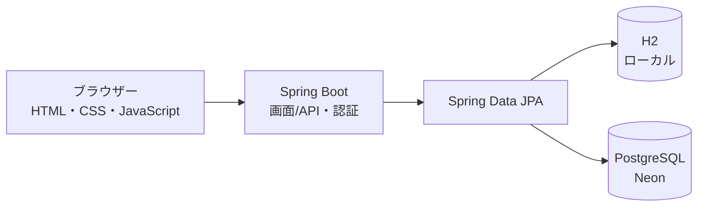

# くらしの家計簿

Java と Spring Boot で作成した、収入と支出を管理する Web アプリです。アカウントごとに家計データを保存し、月ごとの収支や支出の内訳を確認できます。

**公開デモ:** [ログイン画面を開く](https://kakeibo-demo-ffj4.onrender.com/login.html) · [新規登録](https://kakeibo-demo-ffj4.onrender.com/signup.html)

> 公開デモでは、実際の家計情報や個人情報、ほかのサービスで使っているパスワードを入力せず、架空のデータでお試しください。デモ環境では CSV 取り込みを無効にしています。

## アプリについて

日々の支出と収入を記録し、選んだ月の支出合計・収入合計と、月末時点の貯金残高を確認できます。支出はカテゴリーごとに集計され、円グラフでも内訳を表示します。

## 主な機能

- アカウント登録、ログイン、ログアウト
- ログイン中のアカウントごとに収入・支出を分けて保存
- 支出の登録、一覧表示、削除
- 収入の登録、一覧表示
- 月を選んで、その月の記録と集計を表示
- 月末時点の貯金残高を計算
- 支出のカテゴリー別合計、割合、円グラフを表示
- ライトモードとダークモードの切り替え
- スマートフォンに対応した画面

## 使用技術

| 分野 | 技術 |
| --- | --- |
| バックエンド | Java 25、Spring Boot、Spring Web MVC |
| 認証・セキュリティ | Spring Security、セッション認証、CSRF 対策 |
| データアクセス | Spring Data JPA、Hibernate |
| データベース | H2（ローカル実行）、PostgreSQL（公開環境） |
| フロントエンド | HTML、CSS、JavaScript |
| ビルド | Maven Wrapper |
| 公開環境 | Render、Neon |

## アプリの構成



ブラウザーの画面から Spring Boot の API を呼び出し、Java 側で認証やデータの登録・取得を行います。各記録はログイン中のアカウントに結び付けています。ローカルでは H2、公開環境では Neon の PostgreSQL を使用します。

## ローカルでの起動方法

### 必要なもの

- Java 25
- Windows の場合はコマンドプロンプト

### 起動手順

1. このリポジトリをダウンロードまたは clone し、`pom.xml` があるプロジェクトフォルダーを開きます。
2. そのフォルダーでコマンドプロンプトを開きます。
3. 次のコマンドでアプリを起動します。

```bat
mvnw.cmd spring-boot:run
```

4. ブラウザーで [http://localhost:8080/signup.html](http://localhost:8080/signup.html) を開き、アカウントを作成します。
5. 作成したアカウントでログインします。

アカウント名は半角英数字と `.`, `_`, `-` を使った 3〜30 文字、パスワードは 12 文字以上です。アプリを終了するときは、起動中のコマンドプロンプトで `Ctrl + C` を押します。

## 公開デモについて

デモは Render の Web サービスと Neon の PostgreSQL で動作します。無料環境では、アクセスがしばらくないとアプリが休止し、次に開いたとき起動に時間がかかる場合があります。公開設定の手順は [DEPLOY_DEMO.md](DEPLOY_DEMO.md) を参照してください。

## フォルダー構成

```text
src/main/java/com/example/kakeibo/
├── account/    アカウント登録と認証
├── config/     Spring Security とアプリ設定
├── expense/    支出の登録、一覧、削除
├── importing/  旧 CSV データの取り込み
└── income/     収入の登録と一覧

src/main/resources/
├── application.properties
└── static/
    ├── css/    画面ごとのスタイル
    ├── js/     画面ごとの操作処理
    ├── index.html
    ├── login.html
    ├── signup.html
    └── import.html
```

## 設定情報の取り扱い

データベースの接続先やパスワードは、環境変数で設定します。接続情報やパスワードをソースコード、README、公開リポジトリに書かないでください。

